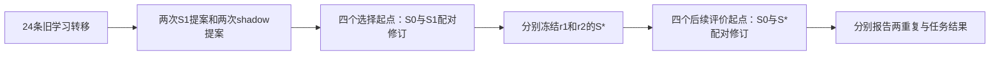

# 从规则提案到后续任务评价：完整调度与模拟验收

这一步把上一轮已经完成的离线接口接成可运行的OpenHands实验：学习外部策略、用任务成绩决定是否采用、冻结策略、再评价后续任务。基础LLM权重保持固定。本轮验收使用真实SDK，但模型回复与任务分数均为预设人工记录，没有启动新的研究实验。

## 已得到的验收证据

实现提交`15144dc0fad8aee0ceae77535563fb6fc1b22144`，正式模拟目录`runs/strategy-pair/sdk-preflight-v01`。在干净提交上完成，未加载真实凭据、未使用真实provider、未执行研究候选。

| 检查 | 实际结果 |
|---|---|
| 最终完整模拟 | 36位置全部接受；SDK→LiteLLM观察36次，模拟provider进入36次；无缺失、无停止 |
| 原始记录审计 | 36条SDK完整链、716条人工测量、2个选择决策回放；`passed_complete` |
| 最大请求 | SDK预算JSON90,616字节，低于98,304上限，余量7,688；不是HTTP线上字节数 |
| 双端测试 | 219项不同测试；服务器219通过，本机207通过、12项因SDK缺失跳过 |
| 测试计数依据 | 先217项相关回归，再因最终CLI修正运行5项，其中3项重复；不相加成222项 |
| 跨端复核 | 7文件准备包逐字节相同；全部3,644原文件哈希通过；本机/服务器审计结果一致 |
| 旧记录 | 236旧运行文件、693旧原档均未改；旧学习包和任务划分未变 |
| 就绪状态 | 新`readiness.json`为true，绑定254文件运行清单；旧准备包false作为历史保留 |
| 新研究活动 | 模型请求、候选执行、拟合、sandbox、VAL、封存评分、S与权重更新均0 |

[机器验收记录](../environment/2026-10-21-strategy-pair-verification.json)与[全部归档](../../artifacts/strategy-pair/2026-10-21/v02/README.md)可逐项查证。归档v02是为Windows路径长度限制缩短目录层级的布局版本；原始正式模拟仍只有sdk-preflight-v01，文件内容未改，原路径映射在manifest中。第一次不完整的本机归档副本保留为本机忽略项，不作为完整证据。

累计研究仍为126请求、已知926,462tokens、已知估算2.9139117元、保守预留12.9983700元。此前两笔usage未知继续保留，实际总额留空；不包括7次连接/调试、Canvas与其他项目，所有本轮模拟用量也排除。

## 为什么这一步必要

我们要研究的具体问题是：从旧修订经历中选出的做事规则，能否改善后续一次程序或公式修订。此前已经有学习材料、接受规则和执行器，但若缺少贯穿它们的调度，仍可能发生预算分散、工具没有真正接受提交、评价反馈提前进入学习、只保留成功运行等问题。新入口让这些条件由代码检查，并为每一步保留可回放的记录。

这一步没有新增研究机制或变更起点。八份v02源码、24条旧转移、四条规则策略的表示、任务划分及36个请求位置均沿用已冻结内容。完整模拟通过后才签发同一运行文件版本的就绪凭证；真实实验须另外建立运行目录和费用总账。

## 实际要怎样比较

`S0`是原先固定的四条规则。每个提案重复读取相同历史材料，从人工八条规则中选择、排列四条，得到`S1`。模型的自由解释只归档，不能直接成为新规则或替代测量。

随后让`S0`和`S1`分别指导四个选择起点的一次修订，两臂共享起点与基线反馈。原始测量必须满足事先冻结的“各配对不退化、至少一项严格收益”条件，才采用`S1`；否则保留`S0`。最终策略记为`S*`。这是保守的接受规则，不能当作显著性检验。

两个重复各自选择、各自报告，禁止只挑表现最好的一次。shadow提案输入相同，输出只归档，用于对齐提案请求次数和上限；这不保证实际tokens、有效计算或信息利用完全相同。两次重复共用历史学习包，也不是两个独立数据集的重复实验。

两个`S*`都冻结后，评价起点才允许任何执行，连先在学习题上获取反馈也必须等到此时。评价成绩不再反向选择策略。如果最终仍是`S0`，比较报告标记`no_policy_change`，不把随机生成差异归因于策略更新。

## 对应到文件

| 文件 | 做了什么 | 为什么需要 |
|---|---|---|
| [控制器](../../rsi_eval/strategy_pair_controller.py)和[SDK适配器](../../rsi_eval/strategy_pair_agent.py) | 一次请求只接受一次合法规则或源码提交，保存原始响应、SDK工具派发和宿主接受记录 | 区分模型说“我提交了”和工具真正接受；不从正文补造提交 |
| [总账](../../rsi_eval/strategy_pair_budget.py) | 一个持久总账覆盖36个固定位置，限制额度与顺序，未知usage停止 | 旧账本最多16会话；不能拆成多个无共同总额约束的小账本 |
| [阶段调度器](../../rsi_eval/strategy_pair_run.py) | 串联提案、共享基线、选择、两个策略冻结和后续评价 | 防止评价信息提前影响S学习，保留每个重复的结果 |
| [派发观察器](../../rsi_eval/strategy_pair_transport.py)和[审计器](../../rsi_eval/strategy_pair_audit.py) | 核对实际SDK→LiteLLM消息、工具、模型/采样参数，以及响应、源码和原始测量之间的绑定 | 保存的计划或声明不能代替实际派发和执行证据 |
| [准备模块](../../rsi_eval/strategy_pair_preparation.py)和[启动入口](../../scripts/run_strategy_pair.py) | 校验旧材料，另冻结254份当前运行文件；真实运行前重验完整模拟 | 新增实现不重写旧冻结包，旧中止轮不恢复或拼接 |
| [模拟执行器](../../rsi_eval/strategy_pair_simulation.py) | 走真实SDK、预算和调度，返回预定模型回复与人工任务记录，同时阻止网络连接 | 验证流程时不读取新的基准任务数值、不执行候选，不消耗模型额度 |

## 如何理解716条记录

完整分配是44条共同基线、160条选择终稿测量、512条后续评价终稿测量，共716条。其中696条为规划、20条为符号。真实轮若无提前停止，最多对应736次sandbox和696次VAL；格式错误等情况不会进入VAL。

716是相关任务测量的数量，不是716个独立样本。本轮这些记录全是人工构造，实际候选执行、拟合、sandbox和VAL次数均为0。最终模拟刻意让两臂保持相同源码和分数，两个重复均保留S0；这验证保留路径，不支持S0或S1的真实优劣。晋级与保留混合情况另有调度器单元测试。

## 实现中修正的边界

SDK一次业务提交成功后可能仍报告迭代上限。适配器仅在提交确已接受、用量已结算、没有其他错误时容许这一特定状态；不会把所有SDK错误都视为成功。

开发模拟在36位置全部完成后暴露了审计入口对Path类型的处理错误，已修复；开发记录保留且不作为最终就绪凭证。最终模拟另用干净提交和新目录完成。另将预算预留、实际SDK派发边界观察、模拟provider进入次数分开报告，避免发送前失败高报调用数。

派发证据止于SDK调用LiteLLM的可信客户端边界，没有观察后续HTTP序列化或获得供应商签名。模拟中测得的最大请求大小只能证明这批人工反馈输入可容纳；真实反馈若变长仍由运行时上限拒绝，不能预先保证真实36位置都完成。

## 下一步和结论边界

下一步是使用已冻结代码、提示和八份v02起点，独立启动最多36请求的真实轮，先学习与选择S，再冻结两个S*并进入后续评价。每请求180秒、零重试，输入预算JSON98,304字节、输出8,192tokens，总保守预留上限12元；异常时停止，不补抽或重写旧成绩。操作命令见[运行说明](../operations/strategy-pair.md)。

即使真实轮完成，仍只是在人工八规则空间内做一次S0→S1→S*；不是开放式新规则发现或多轮递归自我改进。规划只有一个Spanner领域，源码字节/AST不同不保证语义独立；符号仍使用train拟合成绩，公式系数会拟合，不能将基础LLM权重固定理解为所有参数固定。官方300规划测试和8个符号测试CSV继续封存。本轮没有新的机制效果、独立任务优势或泛化结论。
