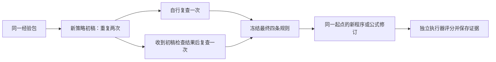

# 推断证据检查：完整配对运行与解释

本轮完成了新协议、受控接口、两次策略提议及其复查、四个修订状态的后续评价。**14次真实请求全部完成，得到8个新候选；检查反馈纠正了一个分支的固定命题判断，但没有观察到稳定的任务收益。** 这是开发实验，不是普适RSI算法的有效性证明。

模型仍为固定权重MiniMax-M3，实验OpenHands SDK仍为1.55.1。实跑代码为 `568f833eebffb4505e87903029ace9eb5f9e0b78`，运行目录为服务器 `runs/inference-policy/20261020-inference-policy-v01`。旧grounded-policy停止轮未恢复或改写。

## 1. 为什么继续做这一步

上一轮暴露了两个不同问题：辅助说明超过短字符上限就丢失整份策略；同时，事实引用完全正确也不保证后面的推断成立。此次分别处理接口与研究问题：

- 四个规则ID决定策略是否合法。判断标签、引用及说明单独检查，辅助字段错误不取消合法策略。
- 检查四个明确命题所需的证据，区分源码变化、具体修复、数值改善、预测落空和结构必要性。
- 一次已知用量的非法提交只记该分支缺失，其它独立分支继续；未知用量、预算或基础设施故障仍停止。

先在测试中发现并修正了“重复合法规则ID仍触发全局停止”的实现错误。本次真实六份策略均合法，因而缺失分支逻辑的证据来自离线回归，不冒充已发生的真实缺失案例。

CRITIC式外部反馈复查是比较动机，外部规则更新与先前ExpeL/GEPA讨论相衔接；这里没有完整复现这些算法，也没有据此声明新颖性。已有来源和采用边界见[上一轮方法依据](../analysis/2026-10-20-grounded-policy-rationale.md)。

## 2. 实际输入与四个判断

[经验装载器](../../rsi_eval/inference_cases.py)从最近完整policy-transfer归档的fixed条件、最小repeat，确定性选择两条完整父子转换：D-P来自EP-r1-fixed，D-S来自ES-r1-fixed。选择规则在本轮调用前冻结，历史记录早已由研究者看过，不能叫独立留出。完整差分、指标、诊断及历史预测都保留；选择理由与谱系见[经验说明](../analysis/2026-10-20-inference-case-selection.md)。

| 固定命题 | 当前可检验内容 | 本轮预期标签 |
|---|---|---|
| C1：规划父子源码字节改变 | 两份源码hash与完整差分 | supported |
| C2：历史理由预期的具体修复没有落实 | 本协议要求预先定义可执行修改契约，当前未提供 | unknown |
| C3：符号训练NMSE改善，但登记预测落空 | NMSE正向变化；预测单独按原MSE量纲检查 | supported |
| C4：新增结构无必要 | 当前没有认证的、范围明确的必要性干预契约 | unknown |

C2/C4的unknown只表示本检查器不作认证，不能解读成现有源码和数据毫无信息。D-P差分实际能看到有向邻接与动作检查被修改；D-S只是给原公式新增v²项，已经提供一个嵌套模型训练比较。它们仍不能自动证明完整修复、物理必要性或独立数据收益。现有命题的范围还不够精细，已在[分析](../analysis/2026-10-20-inference-policy-analysis.md)记录限制，旧评分不事后改动。

## 3. 实验怎样比较

每个初稿分成两个新会话，调用次数与输出上限相同；两份完整SDK请求只允许 `inference_feedback` 不同。所有六个更新槽结束后先冻结文件和策略，再另启进程评价。每个任务状态的两组只允许 `repair_policy` 不同；自由说明、判断标签、检查结果及旧经验均不转给修订Agent。

评价用P-A002、P-H002、S-poly5、S-odd4四个旧状态。P-H002替换P-B002，以避开D-P已知的信息祖先关系。仍只有同一个Spanner开发子集及oscillator1训练集，四个状态不是四个独立任务。旧成绩复制44条（22个不同旧执行ID），没有重跑旧起点，也没有读取封存成绩。

## 4. 策略更新结果

| 初稿组 | 初稿 | 自行复查 | 检查后复查 | 最终策略是否不同 |
|---|---:|---:|---:|---|
| p1 | 3/4 | 3/4 | 4/4 | 是 |
| p2 | 3/4 | 3/4 | 3/4 | 否 |

这些数是四个预设命题及其引用的契约符合数，不是开放解释准确率。六份提交的C1/C2/C4都符合契约，差异全在C3。

D-S的NMSE从0.09591726394降到0.09576767238，确实数值改善；登记的MSE下降至少0.0001，实际仅下降约0.000000652705，因此预测落空。两件事同时成立。p1初稿的说明已经承认两件事，但标签却写contradicted；p1检查复查纠正了标签。p2明确擅自加入“改善须有实质意义”的阈值，收到正确反馈后仍未改正。

p1自行复查保留R03/R04/R06/R08；检查复查改为R02/R05/R04/R07，即强调实际首个故障、诊断到源码改动、精确指标、预测对照。p2两边均为R05/R02/R07/R08。规则全文见[规则目录](../../rsi_eval/revision_policy.py)。规则被选中不等于已证实有用。

C2/C4的证据条件已在两组共同提示中明确给出，初稿也已回答unknown，本轮没有测到反馈使这两项变得更谨慎。检查反馈还直接给出预期标签和理由，所以p1纠正也不能当成模型独立推断能力的证明。

## 5. 后续任务结果

规划为通过数/10（2提示+8开发），符号为oscillator1/train NMSE，越低越好。

| 组/起点 | 起点 | 自行复查策略 | 检查后策略 |
|---|---:|---:|---:|
| p1 / P-A002规划 | 0/10 | 0/10 | 0/10 |
| p1 / S-poly5符号 | 0.09376230 | 0.09224903 | 0.09234137 |
| p2 / P-H002规划 | 0/10 | 10/10 | 0/10 |
| p2 / S-odd4符号 | 0.09180471 | 0.09171468 | 0.09180399 |

实际新增40次规划评价、4次符号拟合。8候选均执行，没有用起点分数代替缺失候选。p2的最终策略及完整输入相同，结果却不同，不能说“检查反馈使规划从10降到0”。只能记录相同策略的两次生成产生了不同程序。p1虽有策略差异，单次结果也不足以估计稳定效应。

一个具体例子：p2检查分支已搜索出11步计划，但输出函数在左括号后多加一个空格，本项目冻结的宿主接口预检查报 `operator_syntax`，公开题执行0动作。自行复查分支输出合法计划，10题均通过。其“计划长度至少增加5”的预测却被支持：预测命中了长度，完全没有保证任务成功。逐份源码与诊断解释见[候选审查](../analysis/2026-10-20-inference-candidate-analysis.md)。

下游8条主张中1支持、5矛盾、2格式错误；8条预测中1支持、6矛盾、1格式错误。上述唯一支持的预测正是计划长度，不能当成一次有效修复。标签正确、解释可靠、选择有用策略和成功执行仍是不同层次。

## 6. 文件、验证与费用

| 文件 | 做了什么，为什么需要 |
|---|---|
| [inference_cases.py](../../rsi_eval/inference_cases.py) | 固定历史经验、核验源hash与指标，并装载四个旧状态，避免输入随结果更换 |
| [inference_policy.py](../../rsi_eval/inference_policy.py) | 分离硬策略与辅助材料，检查四命题、保存初稿及反馈、冻结策略 |
| [inference_policy_agent.py](../../rsi_eval/inference_policy_agent.py) | 接通OpenHands单次提交工具；13字段、原响应保留，有限JSON有整体字节边界 |
| [run_inference_policy.py](../../scripts/run_inference_policy.py) | 六个更新槽、八个修订槽、缺失依赖、预算与分阶段冻结 |
| [analyze_inference_policy.py](../../scripts/analyze_inference_policy.py) | 不调用模型或执行候选，逐条核验请求、响应、策略、执行记录、声明与账本 |
| [冻结协议](../protocols/2026-10-20-inference-policy-v0.1.md) | 事前顺序、比较条件、范围、预算和停止方式 |
| [机器可读审计](../analysis/2026-10-20-inference-policy-audit.json) | 2对复查与4对修订的完整共同输入相同；84份运行源码绑定实跑提交 |
| [完整归档](../../artifacts/inference-policy/2026-10-20/v01/README.md) | 230份服务器原文件逐字节保留，含完整请求、响应和所有候选 |

实跑前525项不同测试通过（任务环境453，SDK环境72），prepare-only为0次模型调用。后续审计及篡改负例见[核验记录](../environment/2026-10-20-inference-policy-verification.json)。SDK中的stopped/单迭代状态不是“没有成果”，实际是否提交与执行由工具事件和候选记录判断。

本轮140,226 tokens，按配置未缓存价估算0.3802617元，保守预留1.6864848元，均在本轮5元及项目300元上限内；14次usage都已知。累计研究请求77次，已知690,339 tokens、已知估算2.0304711元、累计预留8.6591736元；首轮仍有1次未知usage，不能声称项目实际总账已经精确结算。以上不含7次连接调试、Canvas或其它进程费用，不等同供应商账单。

## 7. 下一步的研究判断

这轮已经回答了“完整对照能否运行”和“检查反馈是否必然被采纳”：流程能运行，反馈并不必然被采纳，纠正固定标签也没有自动变成更好的任务结果。

下一步先用已有源码与轨迹定义更精确的局部命题及行为联系，覆盖支持、矛盾、未知三类，而不是扩大当前四问模板。分别判断源码是否改变、具体故障是否消失、整体任务是否成功；符号侧区分训练增益、预测阈值与独立数据效用，并利用已有嵌套模型比较。

值得继续研究的候选机制是：**证据不足时选择有区分力的检查，利用检查结果修正带适用范围的经验，再决定修改动作。** 规划可用动作格式/局部轨迹检查，符号可用指定项的受控比较。这是后续待设计与对照的机制，尚未实现为新方法；本轮14请求额度已用完，不在原协议中追加尝试或修补模型候选。
