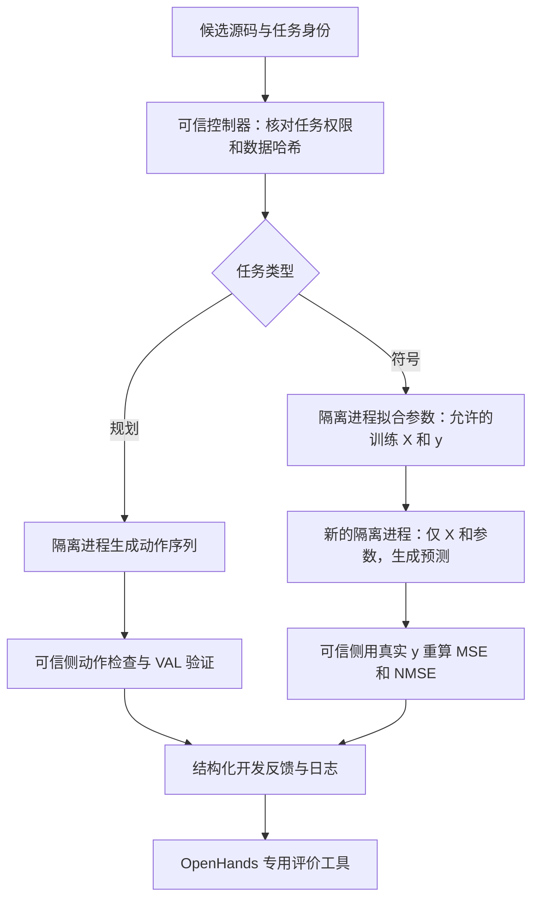

# 两类任务执行器：实现、使用与证据边界

日期：2026-10-20。本轮把已下载的数据接成能够运行候选程序、返回反馈的执行层，并接入 OpenHands SDK 的专用工具。模型调用、Agent rollout 和正式科研实验均为 0。

## 现在能实际做什么

调用者提交任务身份和完整 Python 源码。规划侧执行 `get_plan(objects, init, goal)`，在可信侧检查动作格式、对象和类型，最后由 VAL 检查计划是否可执行且达到目标。符号侧执行 `equation(*inputs, params)`，先拟合常数，再另起进程生成预测，可信侧计算误差。

同一入口记录候选源码 SHA-256、候选/父候选 ID、策略版本、任务身份、执行阶段、状态、耗时和资源限制。原始候选及反馈保存在 `runs/candidates/`、`runs/executor_feedback/`，均被 Git 忽略。策略版本目前只是记录字段，尚未实现策略更新算法。



## 文件与设计理由

| 文件 | 职责 | 为什么这样做 |
|---|---|---|
| `rsi_eval/executor.py` | 统一入口与日志，串联任务装载、隔离运行和可信评价 | 两条路线共用候选身份与反馈结构，为以后比较修订策略保留证据 |
| `rsi_eval/sandbox.py` | 启动 Bubblewrap，限制输入/输出、时间，终止并回收进程 | 普通 Python 子进程和超时本身不能限制文件或网络访问 |
| `rsi_eval/worker.py` | 预载依赖、设置资源限制和 seccomp，再执行候选侧模块 | 在任意候选源码开始运行前建立限制，失败时不回退到宿主直接执行 |
| `rsi_eval/planning.py` | 解析当前任务、限制角色、检查计划并运行 VAL | 规划成功由规则验证决定，不相信候选的自述 |
| `rsi_eval/planning_worker.py` | 在隔离进程调用候选 `get_plan` | 候选只得到当前实例的对象、初始状态、目标，不得到数据目录或验证器 |
| `rsi_eval/symbolic.py` | 读取允许的训练 CSV，在外层重新计算指标 | 拒绝无穷值、丢行、错误维度和伪造分数 |
| `rsi_eval/symbolic_worker.py` | 数值库预热、参数拟合、独立预测 | 把参数估计与可信评分分开，预测进程不接收标签 |
| `rsi_eval/openhands_tool.py` | OpenHands SDK 的专用 `evaluate_candidate` 工具 | 模型接口只接受源码与任务身份，没有 shell、路径或 root 参数 |
| `scripts/evaluate_candidate.py` | 操作者命令行入口 | 可脱离模型单独检查任何候选及其反馈 |
| `scripts/check_task_executors.py` | 两类真实开发数据上的手写样例验收 | 验证完整执行链，而不是只看模块能导入 |
| `scripts/check_openhands_evaluator.py` | SDK 工具派发到执行器的离线往返 | 核实框架接口确实兼容，而不是仅完成代码包装 |
| `tests/`、`fixtures/` | 边界测试与明确标注的手写程序/公式 | 已知正确、已知错误与恶意输出能验证执行器是否给出可靠反馈 |

## 规划侧具体做了什么

当前清单只允许 seed0 的 2 个 prompt 和 8 个 development_feedback 实例。封存测试、其他 seed 的库存任务在读取题目内容前就被拒绝。每次装载都核对域文件和问题文件的哈希。

实现的是 **Spanner 所需的 typed STRIPS 解析子集**，支持当前对象、类型、原子初始状态、合取目标及动作规则；未支持的 PDDL 构造明确拒绝。没有安装完整 PDDLGym，也不声称这份解析器能解释任意 PDDL。当前固定文件和实际输入通过解析与执行验收。

候选的返回值必须是最多 1000 个动作的列表。可信侧先检查括号/字符串、动作名、参数数目、对象存在和对象类型，再调用经过哈希核验的 VAL。程序崩溃、计划格式错误、真实计划失败、验证器问题分别报告。

`fixtures/planning/collect_then_tighten.py` 是为验收手写的通用程序：根据当前实例行走、收集扳手并完成拧紧目标。它通过了全部 10 个允许实例。这个结果证明输入、隔离、动作输出与 VAL 链条连通；它不是 LLM 生成结果、论文复现分数或 RSI 收益。

## 符号侧具体做了什么

只开放 `oscillator1` 与 `oscillator2` 的官方 `train.csv`。当前没有 `split`、文件路径或测试入口参数，`oscillator1/test_id` 等请求被拒绝。目标值仍是 CSV 最后一列。

拟合使用 [SciPy 1.13.1 least_squares](https://docs.scipy.org/doc/scipy-1.13.1/reference/generated/scipy.optimize.least_squares.html)，固定全 1 初始参数，允许 0–16 个参数，设置 `max_nfev=100`。这不是原 LLM-SR 使用 BFGS 的严格复现，而是本执行层明确选用的有界最小二乘实现；未来方法比较时需统一拟合器。

`nfev` 不等于所有候选函数调用数：数值 Jacobian 和最后一次输出检查还会调用公式。因此同时记录 `candidate_calls`。这些是隔离 worker 报告的诊断计数，不能当作面对恶意代码时不可伪造的计费账本；外层时间/输出/进程限制独立生效。未来模型 token 和费用需要另建账本。

拟合成功后，新的进程只接收 X 和拟合参数，不接收 y、优化器状态或上一次进程内存。外层用真实目标重算：

`MSE = mean((y - prediction)^2)`

`NMSE = MSE / Var(y)`，分母采用总体方差。

预测必须为正确长度的一维有限数值序列。NaN/Inf、形状不符、数值溢出和零目标方差均明确拒绝，不丢弃失败观测后继续算出较好分数。

本轮在两题训练数据上分别运行常数和线性公式，共四次成功拟合/评分。测试另用人工已知线性关系验证参数恢复。真实训练误差保存在验收 JSON，**只表示训练拟合质量**，不能解释为泛化、公式发现成功或策略改善。独立预测进程隔离的是标签访问，不会自动消除对训练数据的过拟合。

## 隔离具体限制了什么

使用服务器已有 Bubblewrap 0.6.1 与 Linux namespace，不依赖 Docker daemon。候选视图只包含只读系统运行库、可信 worker、当前源码/请求和独立数值库；没有挂载用户目录、项目、原始数据集、凭据或源码缓存。环境变量重新构造，网络 namespace 隔离；seccomp 进一步禁止网络创建、进程创建、执行外部程序及文件修改等系统调用。

每次候选进程的默认限制是：20 秒墙钟时间、10 秒软 CPU 上限、2 GiB 虚拟地址空间、stdout/stderr 合计 2,000,000 字节。符号 fit/predict 是两个进程，分别应用限制。可信 VAL 最多运行 10 秒。源码上限 64 KiB，请求 JSON 上限 4 MiB。超时或输出过量会终止进程；CPU、内存和异常输出有独立检查。

实际测试覆盖：私有 canary 文件和宿主环境变量不可见，网络/子进程/文件写入被拒绝；CPU、内存、墙钟和输出限制能够触发；触发后下一候选仍能运行；拼接、NaN、溢出数值和深度嵌套的伪造 JSON 不会被接受为有效结果。

这是经测试的候选执行边界，不是独立安全审计或对所有内核攻击的证明。[Bubblewrap 官方说明](https://github.com/containers/bubblewrap/blob/main/README.md)也明确保护范围由调用参数决定。候选进程的自报结果仍不可信，所以计划和数值误差由外层重核验。

## OpenHands 如何使用这一层

`research_agent_tools()` 注册并返回这一个自定义评价工具。Action 接受 family、task_id、source、n_params 及短版本 ID；不接受命令、路径或 root。Observation 只返回白名单字段：状态、错误类别/候选代码行、计划长度、训练指标和运行身份，不返回原始数据、worker 日志或主机路径。

已在实际 SDK 1.55.1 中验证 schema 和派发，并完成规划、符号两次真实工具往返。没有创建 Agent 会话、没有读取模型凭据、没有发模型请求。SDK 自带的会话控制工具不属于此自定义工具列表。

现有 Canvas 通用会话没有被修改。后续研究 Agent 必须明确只配置本工具和必要的会话控制工具；若再给它普通终端/文件工具，本文关于 Agent 无法直接读取项目数据的条件就不成立。本轮完成的是可供研究 Agent 使用的受控执行接口，尚未启动该 Agent 的生成—修订循环。

## 复现与命令

服务器项目根目录执行一个规划候选：

```bash
python3 scripts/evaluate_candidate.py --family planning \
  --task spannerlearning/seed0/problem0 \
  --candidate fixtures/planning/collect_then_tighten.py
```

执行一个三参数符号候选：

```bash
python3 scripts/evaluate_candidate.py --family symbolic --task oscillator1 \
  --candidate fixtures/symbolic/linear.py --n-params 3
```

重跑真实数据验收及 OpenHands 工具往返：

```bash
python3 scripts/check_task_executors.py
.venv/bin/python scripts/check_openhands_evaluator.py
```

任务依赖独立安装在 `.task-runtime/python`，仅 NumPy 1.26.4 和 SciPy 1.13.1；实际 Linux CPython 3.10 wheel 的哈希见 `requirements/task-runtime-linux-py310.lock`。在新服务器有 Bubblewrap/user namespace/libseccomp 的前提下，可用已有 pip 在空目录安装：

```bash
.venv/bin/python -m pip --isolated install --target .task-runtime/python \
  --python-version 3.10 --only-binary=:all: --require-hashes \
  --index-url https://pypi.org/simple -r requirements/task-runtime-linux-py310.lock
```

单元/隔离检查分别使用任务解释器与 SDK 解释器：

```bash
PYTHONPATH=.task-runtime/python python3 -m unittest discover -s tests -v
.venv/bin/python -m unittest tests.test_openhands_tool -v
```

第一条在任务环境执行 39 项，另外 4 项 SDK 测试明确跳过；第二条实际执行这 4 项，合计 43 项不同测试通过。OpenHands 原环境 `pip check` 也通过。

## 验收证据与下一步

`docs/environment/2026-10-20-task-executor-verification.json` 保存代码版本、43 项测试计数、10 个规划开发实例、4 次符号训练拟合、5 项失败/访问限制检查、2 次 SDK 工具往返及原始日志哈希。

下一步应制定一个有调用/token 上限的小规模真实 Agent 方案：准备公开任务说明和初始候选，只使用此工具；固定基础模型、拟合器与资源限制，记录全部尝试。然后明确独立策略选择和最终评价协议，再比较固定策略与更新策略。最终封存评价需要独立控制器，当前接口故意不提供。

目前尚未实现策略更新、冻结实验划分、正式评测、模型费用硬限额或证明新颖贡献；本轮执行层验收不改变这些证据边界。
