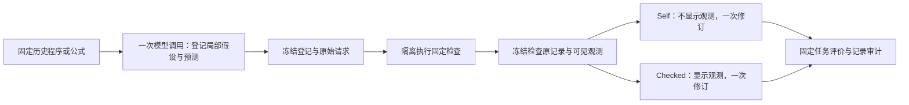

# 两阶段检查与修订实验

本工作单元把上轮已经校准的可执行检查接到 OpenHands：先留下可核对的事前判断，再观察检查结果是否影响下一次实际修改。详细设计与运行前承诺见[协议](../protocols/2026-10-21-two-stage-v0.1.md)。结果与核验在实跑完成后写入对应 analysis/environment 文件。

## 与上一轮有什么区别

上一轮由研究者指定工具并验证：格式变换或删项比较是否真的能够产生有范围的证据。那一轮没有模型调用，也没有证据说明 Agent 会正确使用工具结果。

这一轮连接三个动作：登记假设、执行检查、提交修订。每个起点只有一次共同登记，再分成 self 与 checked；两臂都知道相同检查契约和事前判断，checked 额外得到实际观察。这样主要比较的是工具信息的利用，而不是两组提出了不同问题。每族目前只有一种固定检查，因此它仍不是“Agent 自主选择最佳实验”。

## 为什么是这四个起点

| 起点 | 具体问题 | 为什么保留 |
|---|---|---|
| P-format-missing | 动作字符串缺少括号，历史0/10 | 测试如何处理工具能力不足；空白工具不能凭空补括号 |
| P-prefix | 七步动作合法，但目标没有全部完成，历史0/10 | 区分语法修复与语义补全，避免把任何失败都归成格式问题 |
| S-cubic | 在线性父公式上真实追加三次项 | 检查删掉这一项并重新拟合，训练误差是否增加超过阈值 |
| S-square | 在线性父公式上真实追加二次项 | 使用相同检查机制检验另一结构；不把参数增加自动视为必要 |

这些源码没有用于上一轮五个案例的工具校准，但不是从未见过的数据。两个符号状态来自旧开发轨迹，S-cubic还是后续poly5的祖先，S-square曾用于修订试验。这里寻找的是新接口和局部机制的证据；不是用四个状态替代独立任务验证。

源码来自原模型产物，未为本轮人为构造阳性修复案例。旧归档中部分 trajectory 是当时派生的紧凑视图；装载器保留此来源标签，不把它称为原日志逐字节副本。

## 文件如何分工

| 文件 | 做什么 | 为什么需要 |
|---|---|---|
| `rsi_eval/two_stage_cases.py` | 固定22个输入文件的hash，装载四个真实起点，投影模型可见信息 | 保证没有偷偷换起点，也不把父成绩、旧标签或后继答案传入 |
| `rsi_eval/two_stage_core.py` | 接受登记与候选；公开检查契约；投影观测；计算分数与预测误差 | 把模型的说法、工具的证据、最后执行成绩分开 |
| `rsi_eval/two_stage_agent.py` | 真实OpenHands SDK的两类单次工具会话 | 限定每阶段一次模型请求，保存SDK实际规范化提交；结束状态不能冒充成功提交 |
| `scripts/run_two_stage.py` | 四次登记、阶段冻结、检查、八个固定修订槽位、双重预算 | 让比较顺序与用量可追踪；未知usage或基础设施错误停止 |
| `scripts/analyze_two_stage.py` | 检查源码来源、冻结连续性、反馈投影、实际请求一致性、分数和执行计数 | 排除输入不公平、结果替换和汇总错误；它不重跑任务 |
| `configs/pilots/two-stage-v0.1.json` | 锁定四状态、12请求/64sandbox/5元预留等上限 | 明确这一轮是什么，防止事后增加抽样或重置预算 |

历史 `planning_probe.py`、`symbolic_probe.py`、任务执行器及模型配置保持原版本。新控制器调用它们；模型源码继续只在已有隔离环境执行。

## 什么信息能进入模型

检查前：当前程序/公式、当前历史成绩、当前公开诊断、任务接口、确切检查命题和边界。符号侧还有父公式源码用于定义删除哪一项，但没有父成绩。

检查后 checked 才得到：原状态与干预后的状态/分数、删项差值、阈值及支持/矛盾/未知。不会得到规范化plan、修改后源码、拟合参数或替它决定的下一动作。Self的同一字段为null。审计只移除这个字段，再比较完整保存的SDK请求封装；模型设置、系统提示、工具、共同状态都不能另行忽略。

“支持”只在命题范围内成立。规划只是这两个公开实例上的同一个plan；符号只是既定训练数据、初始化和拟合协议下的删项损失，不是物理必要性或新数据泛化。

## 如何看结果

规划主分数是八开发题成功数，两个用于检查的公开题单独报告。这八题也已经多轮使用，不能称盲测集。符号报告训练NMSE与参数数：误差下降超过数值容差是一类改善；参数减少且误差损失低于1e-5是另一类可接受简化，阈值附近返回不确定。不能只用误差严格下降评价简化。

无候选保留null，不填原分数；实际修改通过源码和执行判断，不能以模型自述“遵循了证据”代替。四个开发状态、每臂一次随机输出，最终无论哪一臂更好，都不足以证明稳定优越性。
